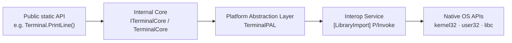

# System.Win32.NET

**A dependency-free .NET library that wraps common Win32 API calls and OS primitives behind clean, static, high-level C# APIs.**

[](LICENSE.txt)
[](https://dotnet.microsoft.com/)
[](https://learn.microsoft.com/dotnet/csharp/)
[](#modules)
[](#at-a-glance)

System.Win32.NET covers bit manipulation, unmanaged memory allocation, classic Windows message boxes, console I/O, process launching, opening the default web browser and starting built-in Windows tools. Each area is exposed as a small static API.

Rather than leaning on higher-level BCL wrappers, the library calls the Win32 API (`kernel32.dll`, `user32.dll`) directly through **source-generated P/Invoke (`LibraryImport`)**. That makes it a compact, readable reference for modern low-level Windows interop in .NET.

## Highlights

- **Modern interop.** Native calls use `[LibraryImport]` source generation, and every P/Invoke declaration lives in a dedicated interop service, separate from the public API.
- **Consistent layered architecture.** Public static API → internal core → platform abstraction layer → interop service, applied the same way in every module.
- **Generic bit operations.** Built on .NET generic math (`IBinaryInteger<T>`), so one allocation-free API works for `int`, `long`, `byte` and any other binary integer type.
- **Defensive by design.** OS checks run before any native call, Windows-only modules fail with a uniform `PlatformNotSupportedException`, inputs are validated and native call results are checked.
- **Zero dependencies, documented.** XML documentation is generated on build, and a prebuilt DLL is included for quick use.

## At a glance

| | |
| --- | --- |
| **Language** | C# with nullable reference types and implicit usings enabled |
| **Target framework** | `net10.0` |
| **Interop** | `LibraryImport` (source-generated P/Invoke) → `kernel32.dll`, `user32.dll`, libc |
| **Unsafe code** | Allowed, only where raw-pointer P/Invoke signatures require it |
| **Dependencies** | None |
| **Documentation** | XML docs generated on build |
| **License** | Apache License 2.0 |

## Architecture

Every module follows the same layered design:



| Layer | Example | Responsibility |
| --- | --- | --- |
| **Public API** | `System32.Terminal.Terminal` | The only public surface: a thin static wrapper that resolves its `Core` instance through a static constructor and a factory. |
| **Internal Core** | `ITerminalCore` / `TerminalCore` | Implements the public contract, applies OS guards where needed and delegates to the PAL. Created through a `*Factory` class. |
| **Platform Abstraction Layer** | `TerminalPAL` | Validates input, checks the OS (`OperatingSystem.IsWindows()`, etc.), converts managed ↔ unmanaged types and calls the interop service. Argument checks and exceptions live here. |
| **Interop Service** | `Terminal_WIN32_InteropService` | Raw `[LibraryImport]` declarations for the native functions. |

This separation keeps every public type a stateless static facade, keeps all P/Invoke declarations isolated from the public API, and means that swapping the implementation for another OS only requires changes in the factory/PAL layer.

## Modules

| Module | Namespace | Platform | What it does |
| --- | --- | --- | --- |
| `Bit` | `System32.BitOperations` | Cross-platform | Generic bit manipulation for any `IBinaryInteger<T>` |
| `MessageWindow` | `System32.GUI` | Windows | Classic Win32 `MessageBoxW` dialogs with buttons, icons and typed responses |
| `Memory` | `System32.Memory` | Windows | Manual unmanaged memory through the process heap (`HeapAlloc` / `HeapReAlloc` / `HeapFree`) |
| `Launcher` | `System32.ProcessLauncher` | Cross-platform | Runs a native command through the C `system()` function |
| `Terminal` | `System32.Terminal` | Windows | Console I/O, colors and beeps via `kernel32.dll`, without `System.Console` |
| `WebBrowser` | `System32.Web` | Cross-platform | Opens a validated URL in the default browser |
| `WindowsApps` | `System32.WindowsAppsManager` | Windows | Launches built-in Windows tools (Calculator, Notepad, Task Manager, …) |

Every Windows-only module checks the OS before any native call and throws `PlatformNotSupportedException` with one shared error message when run elsewhere.

## Quick start

**Requirements:** the [.NET 10 SDK](https://dotnet.microsoft.com/download).

**Build from source**

```bash
git clone https://github.com/Tsvetelinmarinov/System.Win32.NET.git
cd System.Win32.NET
dotnet build System.Win32.NET.csproj -c Release
```

**Use it in your project**

Reference the project:

```bash
dotnet add reference path/to/System.Win32.NET/System.Win32.NET.csproj
```

or reference the prebuilt binary from `Compiled ready-to-use DLL/`:

```xml
<ItemGroup>
  <Reference Include="System.Win32.NET">
    <HintPath>path\to\Compiled ready-to-use DLL\System.Win32.NET.dll</HintPath>
  </Reference>
</ItemGroup>
```

**Hello, Win32** (Windows)

```csharp
using System32.GUI;
using System32.Terminal;

Terminal.ChangeTerminalColors(TerminalForeground.LightGreen, TerminalBackground.Black);
Terminal.PrintLine("Enter your name:");
string name = Terminal.GetLine();
Terminal.ResetColors();

Response answer = MessageWindow.Show(
    message: $"Hello, {name}! Do you want to continue?",
    title: "System.Win32.NET",
    windowType: WindowType.WithButtonsYesNo | WindowType.WithQuestionMark);

if (answer is Response.Yes)
{
    Terminal.PrintLine("Continuing...");
}
```

## Module reference

<details>
<summary><strong>BitOperations</strong> — generic bit manipulation (cross-platform)</summary>

Namespace: `System32.BitOperations`

```csharp
using System32.BitOperations;

long number = 0b0000_1001;

long turnedOn  = Bit.ChangeBitAt(number, bitPosition: 1, BitState.Active);
long turnedOff = Bit.ChangeBitAt(number, bitPosition: 0, BitState.Inactive);
long switched  = Bit.ChangeBitAt(number, bitPosition: 3, BitState.Switch);

long inverted = Bit.InvertAllBits(number);                 // flips every bit
long allOn    = Bit.SetAllBits(number, BitState.Active);   // all bits to 1
long allOff   = Bit.SetAllBits(number, BitState.Inactive); // all bits to 0
```

`BitState` values: `Active` (turn the bit on), `Inactive` (turn it off), `Switch` (toggle it).

</details>

<details>
<summary><strong>GUI (MessageWindow)</strong> — classic Win32 message boxes (Windows only)</summary>

Namespace: `System32.GUI`

```csharp
using System32.GUI;

Response result = MessageWindow.Show(
    message: "Do you want to continue?",
    title: "Confirm",
    windowType: WindowType.WithButtonsYesNo | WindowType.WithQuestionMark);

if (result is Response.Yes)
{
    // ...
}
```

- `message`, `title` and `windowType` are optional; sensible defaults (`"."`, `"Message Window"`, OK button) are applied when they are omitted or invalid.
- `WindowType` flags combine a button set (`WithButtonOK`, `WithButtonsYesNo`, `WithButtonsYesNoCancel`, `WithButtonOKCancel`, `WithButtonsRetryCancel`, `WithButtonsAbortRetryIgnore`, `WithButtonsCancelTryAgainContinue`) with an icon (`WithErrorIcon`, `WithQuestionMark`, `WithWarningIcon`, `WithInfoIcon`) using bitwise OR.
- `Response` mirrors the native `MessageBoxW` return codes: `OK`, `Cancel`, `Abort`, `Retry`, `Ignore`, `Yes`, `No`, `TryAgain`, `Continue`.

</details>

<details>
<summary><strong>Memory</strong> — process-heap allocation (Windows only)</summary>

Namespace: `System32.Memory`

A thin wrapper around the Win32 process heap (`GetProcessHeap`, `HeapAlloc`, `HeapReAlloc`, `HeapFree`) for manual unmanaged memory management.

```csharp
using System32.Memory;

nint block = Memory.Allocate(256);      // zero-initialized 256-byte block
block = Memory.Reallocate(block, 512);  // grow to 512 bytes (the address may change)
Memory.Free(block);                     // release the block
```

> **Note:** this is raw manual memory management. The caller must free every block returned by `Allocate` / `Reallocate`. Because each native call result is validated, an invalid or already-freed pointer surfaces as a `SystemException` from the PAL instead of undefined behavior.

</details>

<details>
<summary><strong>ProcessLauncher</strong> — run native commands (cross-platform)</summary>

Namespace: `System32.ProcessLauncher`

Runs a native process or command through the C standard library's `system()` function.

```csharp
using System32.ProcessLauncher;

int windowsResult = Launcher.Launch("notepad.exe"); // Windows
int unixResult    = Launcher.Launch("ls -la");      // Linux / macOS
```

Returns `0` on success and `-1` if the process fails to start. Because it goes through `system()`, it cannot open URLs; use `WebBrowser` for that.

</details>

<details>
<summary><strong>Terminal</strong> — low-level console I/O (Windows only)</summary>

Namespace: `System32.Terminal`

Console input and output implemented directly on `kernel32.dll` (`ReadConsoleW`, `WriteConsoleW`, `SetConsoleTextAttribute`, `Beep`) instead of `System.Console`.

```csharp
using System32.Terminal;

Terminal.PrintLine("Enter your name:");
string name = Terminal.GetLine();

Terminal.ChangeTerminalColors(TerminalForeground.LightGreen, TerminalBackground.Black);
Terminal.PrintLine($"Hello, {name}!");
Terminal.ResetColors();

Terminal.Beep(duration: 300, frequency: 1000);
```

- `Print` / `PrintLine` accept any `object` (`ToString()` is called internally).
- `TerminalForeground` / `TerminalBackground` are `[Flags]`-style enums that combine into a single console attribute value.

</details>

<details>
<summary><strong>Web (WebBrowser)</strong> — open URLs in the default browser (cross-platform)</summary>

Namespace: `System32.Web`

```csharp
using System32.Web;

WebBrowser.Open();                      // opens https://www.google.com
WebBrowser.Open("https://github.com");  // opens a specific URL
```

The URL is validated (`http` / `https` required, via `Uri.TryCreate`) before `Process.Start` is invoked with `UseShellExecute = true`. An invalid URL throws `InvalidDataException`. URL launching through the shell is most reliable on Windows; on Linux and macOS the result depends on the configured default handler for `http(s)` URLs.

</details>

<details>
<summary><strong>WindowsAppsManager</strong> — launch built-in Windows tools (Windows only)</summary>

Namespace: `System32.WindowsAppsManager`

```csharp
using System32.WindowsAppsManager;

WindowsApps.OpenCalculator();
WindowsApps.OpenNotepad();
WindowsApps.OpenTaskManager();
WindowsApps.OpenFileManager(SystemFolders.Documents); // defaults to Desktop if no path is given
```

Available launchers: `OpenCalculator`, `OpenNotepad`, `OpenPaint`, `OpenSnippingTool`, `OpenTerminal` (Command Prompt), `OpenPowershell`, `OpenTaskManager`, `OpenControlPanel`, `OpenServices`, `OpenRegistryEditor`, `OpenResourceMonitor`, `OpenFileManager(string? path)`.

`SystemFolders` provides ready-made paths for `OpenFileManager`: `Desktop`, `Documents`, `Music`, `Pictures`, `Videos`, `Windows`.

</details>

## Error handling

| Situation | Exception |
| --- | --- |
| A Windows-only module is called on another OS | `PlatformNotSupportedException` |
| Invalid or already-freed heap pointer, or a failed native heap call | `SystemException` |
| Malformed or non-HTTP(S) URL passed to `WebBrowser` | `InvalidDataException` |

## Project structure

```
System.Win32.NET/
├── BitOperations/               # Generic bit manipulation
├── GUI/                         # MessageWindow (MessageBoxW)
├── Interoperability/            # Platform abstraction layer + P/Invoke interop services
├── Memory/                      # Process-heap allocation
├── ProcessLauncher/             # Cross-platform command launching
├── Terminal/                    # Console I/O through kernel32
├── Web/                         # WebBrowser
├── WindowsAppsManager/          # Built-in Windows app launchers
├── Compiled ready-to-use DLL/   # Prebuilt DLL + XML documentation
├── System.Win32.NET.csproj
├── System.Win32.NET.slnx
├── LICENSE.txt
└── README.md
```

## License

Licensed under the [Apache License 2.0](LICENSE.txt).

## Author

**Tsvetelin Marinov** — Junior .NET developer based in Sofia, Bulgaria.
C# · .NET · ASP.NET Core · Entity Framework Core · SQL Server · AvaloniaUI

Open to junior Backend .NET opportunities.

- GitHub: [@Tsvetelinmarinov](https://github.com/Tsvetelinmarinov)
- LinkedIn: [Tsvetelin Marinov](https://www.linkedin.com/in/tsvetelin-marinov-b8aa58344/)
- Email: cvetelinmarinov566@gmail.com
